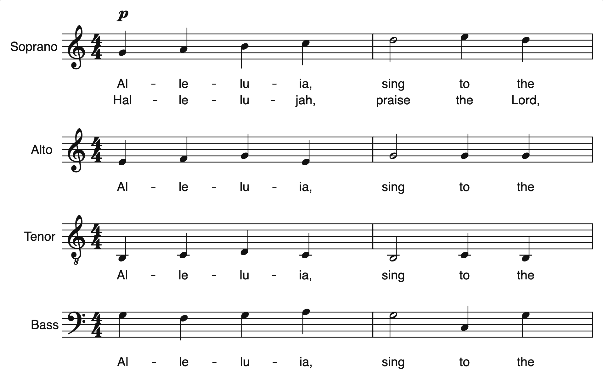

# notation-engine

A from-scratch music notation engine for the web: MusicXML import and
export, engraving, a canvas renderer and Web Audio playback, around an
editable score model. Edits are region-scoped: change one note and only
its measure is laid out and repainted again, not the whole score. No UI
framework and no notation library (VexFlow, OSMD) underneath; the only
bundled asset is the [Bravura](https://github.com/steinbergmedia/bravura)
music font.

It was built for an OMR-correction editor (fixing the output of optical
music recognition note by note), where OpenSheetMusicDisplay's full
re-render on every edit cost over a second per click.



## Install

```bash
npm install notation-engine
```

## Quickstart

`mountScore` renders a score into an element, scrolls it, refits it on
resize and plays it with a moving cursor. The container is the scroll
area, so **it must have a `height` or `max-height`**; without one it grows
to the full height of the score.

```html
<div id="score" style="height: 480px"></div>
<button id="play">Play</button>
```

```js
import { mountScore } from 'notation-engine';

const container = document.getElementById('score');
const playButton = document.getElementById('play');

fetch('/score.musicxml')
	.then((response) => response.text())
	.then((xml) => mountScore(container, xml))
	.then((view) => {
		// Browsers only allow audio after a user gesture, so start playback from a click.
		playButton.addEventListener('click', () => (view.isPlaying ? view.pause() : view.play()));
	});
```

The music font loads automatically from the package; there is no CSS or
asset to wire up.

### Without a bundler

The package is plain ES modules, so it also runs straight from a CDN:

```html
<div id="score" style="height: 480px"></div>
<button id="play">Play</button>
<script type="module">
	import { mountScore } from 'https://cdn.jsdelivr.net/npm/notation-engine@0.1/dist/index.js';

	const xml = await fetch('score.musicxml').then((response) => response.text());
	const view = await mountScore(document.getElementById('score'), xml);
	document.getElementById('play').onclick = () => (view.isPlaying ? view.pause() : view.play());
</script>
```

[`examples/vanilla/index.html`](examples/vanilla/index.html) is a complete
single-file page built this way, with a file picker and transport buttons.

## `mountScore` reference

```ts
mountScore(container: HTMLElement, source: string | Score, options?: MountOptions): Promise<ScoreView>
```

`source` is a MusicXML (`score-partwise`) string or a `Score` object. The
promise resolves once the music font has loaded and the first paint is done.
The view appends a canvas sized to the visible area plus a spacer for the
rest of the score's height, and sets `overflow: auto` on the container if it
was `visible`.

**Options** (`MountOptions`, all optional):

| Option          | Default        | What it does |
| --------------- | -------------- | ------------ |
| `staffSpacePx`  | `10`           | Pixels between two staff lines; this is the zoom. |
| `systemWidthPx` | container width | Fixed system (line) width. Omit it to fit the container and re-cast-off on resize. |
| `fontUrl`       | bundled Bravura | Where to load the SMuFL font from. |
| `renderer`      | built-in colours | `CanvasRendererOptions` minus `fontFamily`: `foreground`, `background` (`null` for transparent), `selection`, `playbackCursor`, `measureRange`, `seamMarker`, `labelFontFamily`. |
| `followScroll`  | `true`         | Scroll the container to keep the playback cursor in view. |
| `playback`      | `true`         | `false` makes the view silent: `play()` does nothing and no `AudioContext` is created. |

**Handle** (`ScoreView`):

| Member | |
| ------ | - |
| `load(source)` | Show a new score (MusicXML string or `Score`): stops playback, re-lays-out, scrolls to the top. |
| `play()` / `pause()` / `stop()` | Transport. The first `play()` creates the `AudioContext`, so call it from a click handler. `stop()` rewinds and clears the cursor. |
| `seek(seconds)` | Jump to a position, playing on from there if playing. |
| `seekToNote(noteId)` | Seek to the first time a note sounds; returns `false` for a note that never sounds. |
| `isPlaying`, `positionSeconds`, `durationSeconds` | Read-only playback state. `durationSeconds` includes repeats. |
| `setZoom(staffSpacePx)`, `staffSpacePx` | Re-lay-out at a new staff size, keeping the same part of the score in view. |
| `scrollToNote(noteId)` | Scroll the note's measure into view. |
| `on(name, handler)` | Subscribe; returns an unsubscribe function. Events: `'noteclick'` `(hit, pointerEvent)` with `hit` `null` on empty space; `'onset'` `(event)` as each note starts playing; `'end'` `()` when playback runs off the end. |
| `destroy()` | Remove the canvas and listeners, stop playback and close the `AudioContext`. Safe to call twice. |

**Escape hatches**, for hosts that build editing on top: `score`, `layout`,
`renderer` (selection and highlights set on it survive relayouts) and
`canvas`. After editing `view.score` in place, call `refresh(changed)` with
the `MeasureRef`s the edit op returned to re-lay-out and repaint only those
measures (it falls back to a full pass when a measure's width changed, and
returns whether the scoped path held). `setScore(score)` swaps in a
different `Score` object, such as the one `EditHistory.undo()` returns,
without stopping playback or moving the scroll position.

```js
view.on('noteclick', (hit) => {
	if (!hit) return;
	const changed = view.score.noteToRest(hit.noteId); // the measures it touched, or null
	if (changed) view.refresh(changed);
});
```

## Frameworks

The core never touches a framework, so a component is a mount in an effect
and a `destroy()` in its cleanup. In React:

```tsx
import { useEffect, useRef } from 'react';
import { mountScore, type ScoreView } from 'notation-engine';

export function ScorePlayer({ xml }: { xml: string }) {
	const container = useRef<HTMLDivElement>(null);
	const view = useRef<ScoreView | null>(null);

	useEffect(() => {
		let disposed = false;
		mountScore(container.current!, xml).then((mounted) => {
			if (disposed) mounted.destroy();
			else view.current = mounted;
		});
		return () => {
			disposed = true;
			view.current?.destroy();
			view.current = null;
		};
	}, [xml]);

	return (
		<>
			<div ref={container} style={{ height: 480 }} />
			<button onClick={() => view.current?.play()}>Play</button>
		</>
	);
}
```

The `disposed` flag matters because `mountScore` is async: an unmount (or
React's strict-mode double effect) can land before it resolves. Vue
(`onMounted`/`onBeforeUnmount`) and Svelte (`onMount` returning a cleanup)
take the same shape.

## Lower-level API

`mountScore` is a thin layer over a public API you can use directly, for
example to build an editor or render without the built-in scrolling. Every
export carries doc comments in its `.d.ts`; the outline:

- **Model** (`Score`, `Staff`, `Measure`, `Note`, `buildScore`): the
  editable score. Edit ops on `Score` (`transposeNote`, `noteToRest`,
  `restToNote`, `setDuration`, `addChordMember`, `removeChordMember`,
  `editTie`, `setClefRange`, ...) mutate in place and report what they
  touched (most return the `MeasureRef[]` that `refresh` takes, or `null`
  for no change). `EditHistory` wraps a score with `record(edit)`, `undo()`,
  `redo()`, `dirty` and `markSaved()`, using structural snapshots.
- **MusicXML**: `importMusicXml(xml, { diagnostics })` and
  `exportMusicXml(score)`. Elements the model does not represent are kept
  as opaque passthrough and written back on export, so import, edit, export
  loses nothing. `createImportDiagnostics()` collects what was dropped or
  approximated instead of logging it.
- **Layout and rendering**: `layoutScore(score, { staffSpacePx,
  systemWidthPx })` returns positioned draw ops per measure;
  `CanvasRenderer` paints them onto any `CanvasRenderingContext2D`
  (`drawAll()`, `redrawMeasure(index, staffIndex)`,
  `redrawMeasures(indices, staffIndex)`, `setSelection`,
  `setPlaybackCursor`, `setMeasureRange`, `setViewport`).
  `relayoutMeasure(score, layout, measureIndex, options, staffIndex)`
  re-lays-out one measure (or returns `null` when its width changed), and
  `hitTest(layout, x, y)` / `hitTestMeasure` map a point back to a note or
  measure. `loadSmuflFont()` loads the bundled font and resolves to the
  family name for the renderer.
- **Playback**: `computePlaybackTimeline(score)` turns a score into timed
  note events (repeats unfolded); `PlaybackEngine({ events, audioContext,
  onOnset, onEnd })` plays them with `play`/`pause`/`stop`/`seek`.
- **Examples**: `notation-engine/examples` exports small showcase scores
  built in code (`createFullDemoScore`, `createGrandStaffShowcaseScore`,
  `createChordShowcaseScore`, ...), handy for trying the engine without a
  MusicXML file. Their content may change between releases.

The edit-and-redraw loop, without `mountScore`:

```js
import { CanvasRenderer, EditHistory, hitTest, importMusicXml, layoutScore, loadSmuflFont, relayoutMeasure } from 'notation-engine';

const options = { staffSpacePx: 10, systemWidthPx: 900 };
const history = new EditHistory(importMusicXml(xml));
let layout = layoutScore(history.current, options);
canvas.width = layout.width;
canvas.height = layout.height;
const renderer = new CanvasRenderer(canvas.getContext('2d'), layout, { fontFamily: await loadSmuflFont() });
renderer.drawAll();

canvas.addEventListener('pointerdown', (event) => {
	const hit = hitTest(layout, event.offsetX, event.offsetY);
	if (!hit) return;
	const changed = history.record((score) => score.noteToRest(hit.noteId));
	for (const { staffIndex, measureIndex } of changed ?? []) {
		const scoped = relayoutMeasure(history.current, layout, measureIndex, options, staffIndex);
		layout = scoped ?? layoutScore(history.current, options);
		renderer.setLayout(layout);
		if (scoped) renderer.redrawMeasure(measureIndex, staffIndex); // only this measure repaints
		else renderer.drawAll();
	}
});
```

### Headless rendering (Node)

The layout, model, MusicXML and timeline layers run in Node with no DOM.
To rasterize, use [node-canvas](https://github.com/Automattic/node-canvas)
and register Bravura with it directly (`loadSmuflFont` needs a browser
document). node-canvas cannot read the WOFF2 file the package ships, so
register an OTF copy of the font, such as `redist/otf/Bravura.otf` from
the [Bravura repository](https://github.com/steinbergmedia/bravura):

```js
import { createCanvas, registerFont } from 'canvas';
import { CanvasRenderer, importMusicXml, layoutScore } from 'notation-engine';

registerFont('./Bravura.otf', { family: 'Bravura' });
const layout = layoutScore(importMusicXml(xml), { systemWidthPx: 1200 });
const canvas = createCanvas(Math.ceil(layout.width), Math.ceil(layout.height));
new CanvasRenderer(canvas.getContext('2d'), layout, { fontFamily: 'Bravura' }).drawAll();
```

## Bundler notes

- The font is located with `new URL('./Bravura.woff2', import.meta.url)`,
  which Vite, webpack 5 and browser ESM from a CDN all resolve with no
  configuration. Where a tool breaks that URL (Vite dev pre-bundling,
  esbuild), the engine falls back to a lazily imported chunk holding the
  font as a data URL, so it still works with no setup.
- esbuild with `--bundle` but without `--splitting` cannot keep that
  fallback lazy, so it folds the 431KB chunk into your main bundle. Use
  `--splitting --format=esm`, or serve `Bravura.woff2` yourself and pass
  its URL as `fontUrl`.
- `sideEffects: false`: importing the package does nothing at module load,
  so it is safe to import during server-side rendering (call `mountScore`
  only in the browser).

## What's supported

- Multiple staves and parts, grand staff braces and part-group brackets,
  part names; several voices per staff, chords, cross-staff beams.
- Note values from whole to 64th, dots, rests (including whole-measure
  rests), beams, ties, slurs, tuplet timing.
- Key, time and clef changes, including mid-measure clef changes; treble,
  bass, octave-treble, alto and tenor clefs; accidentals carried through
  the measure.
- Articulations (staccato, staccatissimo, accent, marcato, tenuto,
  detached legato) and fermatas; dynamics and crescendo/diminuendo
  hairpins; grace notes (acciaccatura and appoggiatura).
- Lyrics: multiple verses, hyphens and extenders.
- Barlines, repeats and 1st/2nd endings (voltas), unfolded in playback.
- Playback: dynamics, articulations, fermatas and grace notes shape the
  sound; a cursor follows the music, including through repeats.
- MusicXML: lossless round trip, since unmodelled elements pass through
  untouched; import diagnostics report anything dropped or approximated.
- Editing primitives with undo/redo and region-scoped redraw; hit-testing,
  selection, measure-range selection and seam-marker overlays.

## Known limitations

- Beams are flat, not angled to the melodic contour. Tuplets play and
  space correctly but their brackets and numbers are not drawn.
- Casting-off is greedy (no balanced line breaking), and spacing in dense
  multi-staff music is loose. One long scrolling page: no pagination,
  printing or PDF/SVG export.
- Changes of key, time or clef at a system break are not announced at the
  end of the previous system.
- Collision avoidance is partial: dynamics, hairpins, slurs and
  articulations do not all avoid each other, unisons in chords overlap, and
  very busy multi-voice passages can crowd.
- No segno, coda, D.C./D.S./Fine or nested repeats.
- Playback uses one tempo for the whole score and a simple oscillator
  synth, not sampled instruments.
- MusicXML import reads `score-partwise` XML only (no compressed `.mxl`, no
  `score-timewise`); breves, C1/C2/C5 clefs and unpitched percussion are
  approximated; `print-object="no"` is ignored, so hidden objects draw.
- Some attributes of modelled elements (explicit positions, measure
  widths, `placement`) are not kept on export.
- Edit ops cover pitch, duration, rests, chords, ties and clefs, not yet
  marks, dynamics, grace notes or lyrics.
- `mountScore` hears an edit made during playback only from the next
  pause or stop.

Browser support: current evergreen browsers (Chrome, Edge, Firefox,
Safari). It needs Canvas 2D, Web Audio, the `FontFace` API and
`ResizeObserver`.

## Design principles

- **No engraving or rendering library underneath.** A
  [SMuFL](https://w3c.github.io/smufl/) font (Bravura, SIL OFL) supplies
  glyph shapes; layout and drawing are this project's own.
- **Framework-agnostic core.** Model, layout, rendering, playback and
  MusicXML depend only on standard web APIs (and not even the DOM, except
  the renderer's `CanvasRenderingContext2D`). The host owns events and
  calls in; `mountScore` is just the common case of that wiring.
- **Canvas, not a DOM or SVG node per note.** One canvas and our own
  hit-testing, so a redraw never means diffing or rebuilding a tree.
- **Region-scoped redraw is the core invariant.** An edit re-lays-out and
  repaints only the measures it touched, and the test suite asserts it: a
  one-measure edit issues every drawing call inside that measure's region,
  and the call count does not grow with the score. On a laptop
  (`npm run bench`) a scoped edit stays around 0.1 to 0.2 ms whatever the
  score's length, while a full repaint grows from under 1 ms at 4 measures
  to about 12 ms at 124.
- **MusicXML in, MusicXML out**, without losing what the model does not
  understand.

## Development

```bash
npm install
npm run dev     # demo page (demo/) at the printed localhost URL
npm test        # vitest, no DOM or canvas needed
npm run check   # tsc --noEmit
npm run build   # library build to dist/
npm run smoke   # build, pack, install the tarball and import it like a user
npm run bench   # redraw timings, rasterized through node-canvas
npm run glyphs  # regenerate glyph metrics from assets/bravura/
```

See [CONTRIBUTING.md](CONTRIBUTING.md) for the architecture, testing policy
and how to propose changes, and [plan.md](plan.md) for the roadmap and
design record.

## License

The code is [MIT](LICENSE). The bundled Bravura font is by Steinberg Media
Technologies under the [SIL Open Font License 1.1](https://openfontlicense.org/);
its license ships as `dist/Bravura-OFL.txt`.
